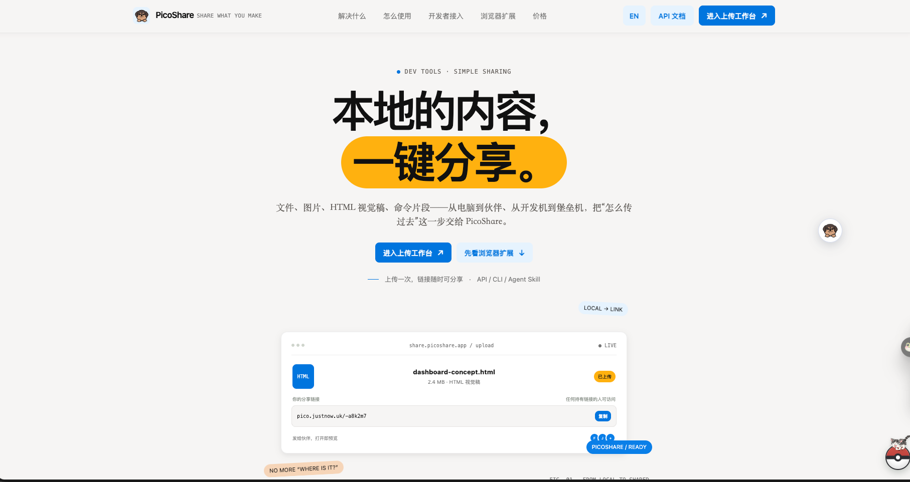
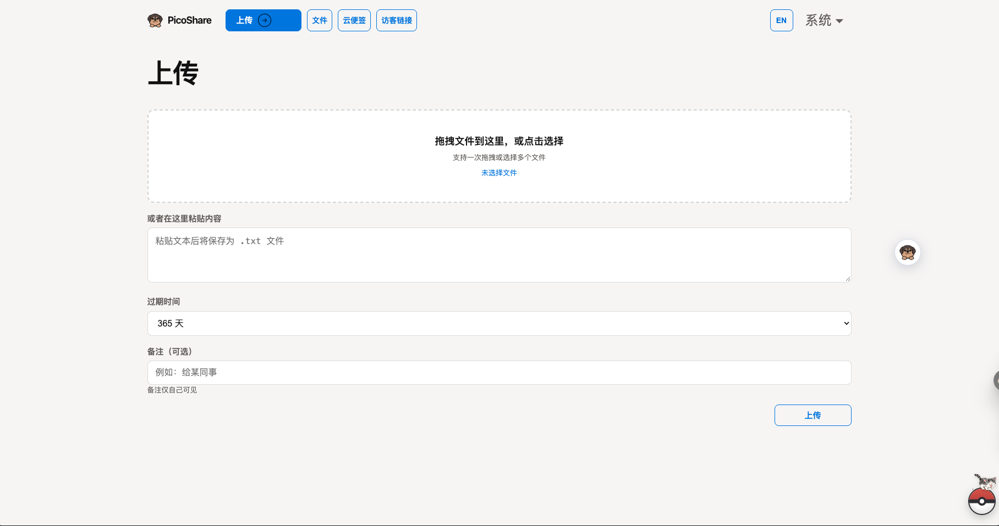
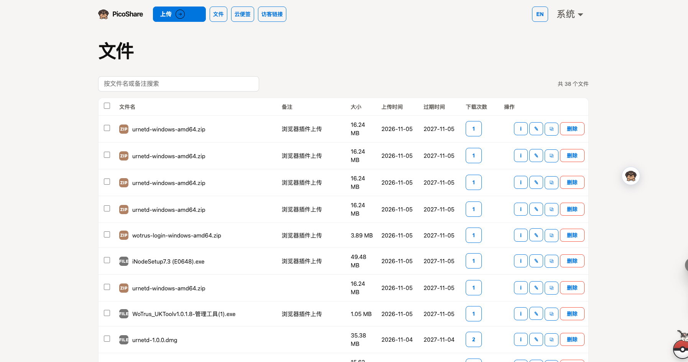
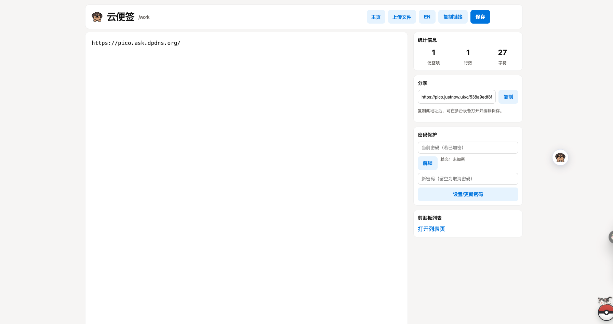
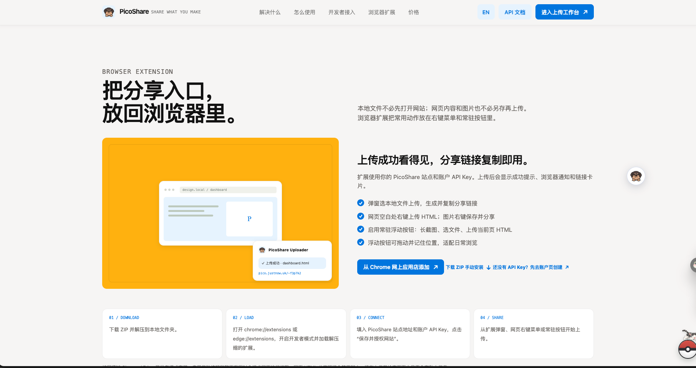
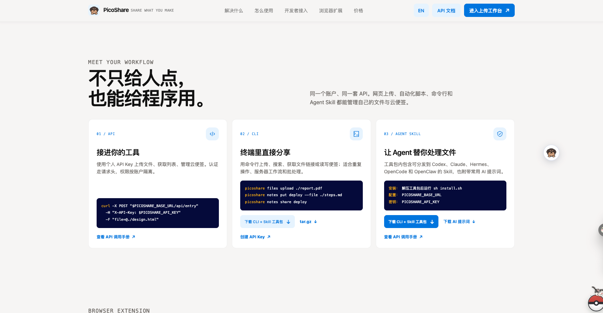
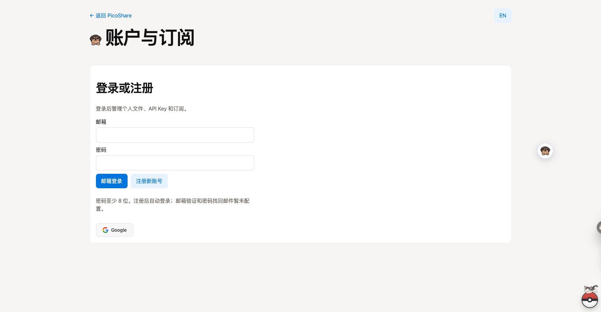

# PicoShare TS

[English](#english) | [简体中文](#简体中文)

<a id="english"></a>

PicoShare TS is a file-sharing and cloud-notes application built with **Cloudflare Workers, D1, R2, and KV**. Deploy it as a personal, single-owner service or enable the optional SaaS account and billing layer. A local Docker runtime is also provided for evaluation and small self-hosted installations.

> **Choose a deployment mode**
> - **Personal / single-owner:** simplest Cloudflare deployment; protect the management UI with a shared secret and optionally use a global API key.
> - **SaaS:** add email/password accounts, optional Google OAuth, per-user data isolation, quotas, API keys, and optional billing providers.
> - **Docker:** runs locally with persistent data under `/data`; it is not a Cloudflare deployment.

## Product screenshots

Screenshots are stored in this repository under [`docs/images/readme/`](docs/images/readme/).

| Landing page | Upload page |
|---|---|
|  |  |

| File list | Cloud notes |
|---|---|
|  |  |

| Browser extension | Developer workflow |
|---|---|
|  |  |

| SaaS account |
|---|
|  |

Product introduction videos: [中文](public/videos/picoshare-intro-zh-full.mp4) · [English](public/videos/picoshare-intro-en-full.mp4).

## Features

- Upload by file picker, drag-and-drop, or pasted text; list, inspect, edit, replace, and delete files.
- Shareable file links, optional expiration, MD5 tracking, version history, and download history.
- Guest upload links for collecting files without giving uploaders account access.
- Cloud notes (`/clips` and `/:name`) with password protection, autosave, and share-link editing. Treat a share link as a bearer credential; anyone with access to it may edit according to the note's sharing/password settings.
- English and Chinese UI; HTML file shares support dynamic rendering in a sandboxed browser context.
- Optional SaaS accounts, per-user isolation and quotas, personal API keys, Pro entitlements, and payment integrations.
- Static landing page is indexable; private application and share surfaces send no-index directives. These directives are crawler guidance, not access control.

## Requirements

- Node.js 20+ (recommended) and npm.
- A Cloudflare account for Worker hosting, D1, R2, and KV.
- Wrangler CLI (included as a development dependency; use `npx wrangler`).

## Deploy to Cloudflare Workers

This is the recommended production path. The Worker uses D1 for metadata and account data, R2 for file objects, and KV for cloud notes. **Binding names are part of the application contract and must remain `DB`, `BUCKET`, and `CLIPBOARD`.**

### 1. Install and authenticate

```bash
npm ci
npx wrangler login
npx wrangler whoami
```

Make sure Wrangler is logged into the intended Cloudflare account.

### 2. Create the Cloudflare resources

```bash
npx wrangler d1 create picoshare_db
npx wrangler r2 bucket create picoshare-files
npx wrangler kv namespace create picoshare-clips
```

Copy the returned D1 `database_id` and KV namespace `id`. Create local config from the example and update the IDs/bucket name:

```bash
cp wrangler.toml.example wrangler.toml
```

In `wrangler.toml`, set the actual Cloudflare `account_id`, D1 ID, R2 bucket name, and KV ID. Keep the binding names unchanged:

```toml
[[d1_databases]]
binding = "DB"
database_name = "picoshare_db"
database_id = "<your-d1-database-id>"

[[r2_buckets]]
binding = "BUCKET"
bucket_name = "picoshare-files"

[[kv_namespaces]]
binding = "CLIPBOARD"
id = "<your-kv-namespace-id>"
```

The example also includes `nodejs_compat` and static assets configuration. Do not make the R2 bucket public; the Worker accesses it through its binding.

### 3. Set the personal-mode secret

Set a strong, unique Worker secret. Do not keep `replace-me`, put production secrets in `wrangler.toml`, or commit `.dev.vars`.

```bash
npx wrangler secret put PS_SHARED_SECRET
```

Optional: set `PS_API_KEY` as a separate secret for scripts, integrations, and browser extensions. In personal mode, the shared secret protects the management UI and the API key authorizes protected API routes; keep both private.

```bash
npx wrangler secret put PS_API_KEY
```

### 4. Initialize the remote database and deploy

For a **new D1 database only**, apply the baseline schema before the first deployment:

```bash
npx wrangler d1 execute picoshare_db --remote --file=./schema.sql
npx wrangler deploy
```

Do not reapply the baseline schema as an upgrade procedure to an existing production database. The Worker performs idempotent runtime schema initialization for supported changes. Back up production data before upgrades.

Wrangler deploys the Worker and its configured triggers. To use a custom hostname, configure the route or custom domain for your own Cloudflare zone in `wrangler.toml`; do not copy another installation's account IDs, secrets, or domain settings.

## Optional SaaS mode

SaaS is an optional layer on the same Worker and Cloudflare resources. Enable it only after completing a basic personal-mode deployment and configuring authentication. It supports:

- Email/password registration and login through Better Auth.
- Optional Google OAuth.
- Per-account files, guest links, cloud notes, API keys, and plan limits.
- Free and Pro entitlements, subscription/account management, and superadmin tools.
- Optional Waffo subscription checkout and Chinese-interface OPCPay/Alipay checkout.

**Email verification and password-reset email delivery are not configured by this repository.** Integrate and test a mail provider before relying on account recovery in a public SaaS deployment.

### Authentication setup

Set these non-secret variables in `[vars]` in `wrangler.toml`:

```toml
[vars]
ENABLE_SAAS = "true"
BETTER_AUTH_URL = "https://share.example.com"
# Optional: comma-separated superadmin email addresses
SAAS_SUPERADMIN_EMAILS = "admin@example.com"
```

`BETTER_AUTH_URL` must be the canonical public HTTPS origin. Set the Better Auth signing secret (at least 32 characters) with Wrangler:

```bash
npx wrangler secret put BETTER_AUTH_SECRET
```

Google login is optional. If enabling it, create OAuth credentials and register this exact redirect URI with Google:

```text
https://share.example.com/api/auth/callback/google
```

Then store the client credentials as Worker secrets:

```bash
npx wrangler secret put GOOGLE_CLIENT_ID
npx wrangler secret put GOOGLE_CLIENT_SECRET
```

The account domain should use HTTPS in production. Configure the canonical domain and trusted proxy/origin behavior for your own deployment; do not alter Cloudflare routes unless your deployment requires it.

### Optional billing providers

Billing is not required for account registration or free-tier use. Configure only the provider(s) you intend to offer.

**Waffo Pancake** provides the subscription checkout and customer portal. Create monthly and yearly Pro subscription products, then configure these variables:

```toml
WAFFO_ENV = "test" # switch to "prod" only after sandbox validation
WAFFO_CURRENCY = "USD"
WAFFO_PRODUCT_PRO_MONTHLY = "<monthly-product-id>"
WAFFO_PRODUCT_PRO_YEARLY = "<yearly-product-id>"
# WAFFO_STORE_ID = "<store-id>" # needed for the customer portal
```

Store merchant credentials as secrets:

```bash
npx wrangler secret put WAFFO_MERCHANT_ID
npx wrangler secret put WAFFO_PRIVATE_KEY
```

Configure a raw-payload webhook at `https://share.example.com/api/webhooks/waffo` and subscribe it to: `subscription.activated`, `subscription.payment_succeeded`, `subscription.renewed`, `subscription.recovered`, `subscription.plan_changed`, `subscription.canceling`, `subscription.uncanceled`, `subscription.canceled`, `subscription.past_due`, and `refund.succeeded`. Test the full checkout and webhook lifecycle before switching `WAFFO_ENV` to `prod`.

**OPCPay / Alipay** is displayed in the Chinese account UI; the English billing UI continues to use Waffo. Store the API key as a Worker secret and optionally set a different API base URL if your provider account requires it:

```bash
npx wrangler secret put OPCPAY_API_KEY
```

```toml
# Optional; the code has a default API base URL.
# OPCPAY_API_BASE_URL = "https://pay.66opc.com/api/pay/v1"
```

Payment providers, product IDs, webhook delivery, and live payment acceptance are external account responsibilities. Do not publish secrets in source control or issue reports.

### Plan limits and onboarding existing data

Current limits are defined in [`src/lib/saas.ts`](src/lib/saas.ts):

| Limit | Free | Pro |
|---|---:|---:|
| Total storage | 1 GiB | 5 GiB |
| Maximum file size | 100 MiB | 1 GiB |
| Maximum file retention | 30 days | 365 days |
| Cloud notes | 5 × 32 KiB | 20 × 128 KiB |
| API-key requests | 500/month, 10/minute | 5,000/month, 60/minute |
| API keys | 1 | 3 |
| Active guest links | 3 | 20 |

To bootstrap existing personal-mode files and guest links into a first SaaS account, temporarily set `SAAS_BOOTSTRAP_EMAIL` to the intended account email. Have that account sign in, verify the data ownership, then remove the variable. Plan limits and prices are application configuration; ensure provider products match your intended commercial offer before enabling live checkout.

## Local development

```bash
npm ci
cp wrangler.toml.example wrangler.toml
cp .dev.vars.example .dev.vars
```

Replace the example D1/KV IDs and set a local-only `PS_SHARED_SECRET` in `.dev.vars`. Initialize local D1 and run checks:

```bash
npx wrangler d1 execute picoshare_db --local --file=./schema.sql
npm run typecheck
npm test
npx wrangler dev --port 8787
```

Open `http://localhost:8787`. By default, Wrangler uses local simulated bindings; local uploads do not appear in production. Avoid remote bindings during normal development unless you intentionally want to access a separate staging environment.

## Docker local runtime

Docker runs the Worker with local Wrangler storage and persists its state under `/data`. This is **not** a Cloudflare D1/R2 production deployment.

```bash
docker build -t picoshare-ts:local .
docker run --rm -it \
  -p 8787:8787 \
  -e PS_SHARED_SECRET='replace-with-a-long-random-secret' \
  -v "$(pwd)/.docker-data:/data" \
  picoshare-ts:local
```

Open `http://localhost:8787`. Keep the `/data` volume backed up. Do not expose the container publicly with a sample/default password; put it behind HTTPS and a correctly configured reverse proxy if making it reachable beyond localhost.

## API integration

In personal mode, provide `PS_API_KEY` (or the supported shared secret) in `X-API-Key` or `Authorization: Bearer ...` for protected API routes. In SaaS mode, each user creates/revokes a personal key at `/account`; it is scoped to that account and is subject to that account's usage limits.

```bash
export PICOSHARE_URL="https://share.example.com"
export PS_API_KEY="<your-api-key>"

curl -H "X-API-Key: $PS_API_KEY" "$PICOSHARE_URL/api/entries"
curl -X POST -H "X-API-Key: $PS_API_KEY" \
  -F "file=@./example.png" "$PICOSHARE_URL/api/entry"
```

An upload response includes an `id`; the share URL is `$PICOSHARE_URL/-<id>`. See [`/api-docs`](https://pico.justnow.uk/api-docs) on the public demo deployment or the in-app `/api-docs` page on your instance.

## Development and contribution

```bash
npm ci
npm run typecheck
npm test
```

The tests use Vitest. Before submitting changes, run typecheck and tests, and do not commit `wrangler.toml`, `.dev.vars`, `.env` files, private keys, or real credentials. For database schema changes, include migration notes and verify against a disposable D1 database.

## Documentation

- [Cloudflare deployment and release guide](docs/DEPLOYMENT.zh-CN.md)
- [Chinese usage and configuration guide](docs/README.zh-CN.md)
- [Configuration template and secrets](docs/CONFIG_TEMPLATE.md)
- [Wrangler configuration example](wrangler.toml.example)
- [Local development variables example](.dev.vars.example)

---

<a id="简体中文"></a>

# PicoShare TS（简体中文）

PicoShare TS 是基于 **Cloudflare Workers、D1、R2 和 KV** 的文件分享与云便签服务。支持两种 Cloudflare 部署模式：个人/单用户模式，以及可选的 SaaS 账号与计费模式；也提供用于本地体验或小规模自托管的 Docker 运行方式。

> **先选部署模式**
> - **个人模式（推荐先部署）**：共享密钥保护管理界面，可选独立 API Key；适合个人或单一团队。
> - **SaaS 模式**：增加邮箱/密码账号、可选 Google 登录、用户数据隔离、套餐额度、个人 API Key 和可选支付接入。
> - **Docker 模式**：使用本地模拟存储，数据保存在 `/data`，不是 Cloudflare 生产部署。

## 产品截图

截图保存在仓库 [`docs/images/readme/`](docs/images/readme/) 目录，克隆项目后可直接查看。

| 产品首页 | 文件上传 |
|---|---|
|  |  |

| 文件列表 | 云便签 |
|---|---|
|  |  |

| 浏览器扩展 | 开发者集成 |
|---|---|
|  |  |

| SaaS 账户 |
|---|
|  |

产品介绍视频：[中文](public/videos/picoshare-intro-zh-full.mp4) · [English](public/videos/picoshare-intro-en-full.mp4)。

## 功能概览

- 文件选择、拖放、粘贴上传；文件列表、详情、编辑、同名替换和删除。
- 分享链接、可选过期时间、MD5、版本历史和下载记录。
- 访客上传链接：访客无需获得账号权限即可上传文件。
- 云便签（`/clips`、`/:name`）：密码保护、自动保存和分享链接多设备编辑。分享链接属于访问凭据；获得链接的人可按便签分享/密码设置进行访问或编辑。
- 中英文界面；HTML 分享支持沙箱隔离环境中的动态渲染。
- 可选 SaaS 账号、用户数据隔离和额度、个人 API Key、Pro 权益及支付接入。
- 首页静态内容允许搜索索引，应用及分享路径默认声明不索引。Robots 指令只是爬虫声明，不等于访问控制。

## 环境要求

- Node.js 20+（建议）和 npm。
- Cloudflare 账号（Worker、D1、R2、KV）。
- Wrangler（项目开发依赖中已包含，通过 `npx wrangler` 使用）。

## 部署到 Cloudflare Workers

这是推荐的线上部署方式。D1 保存元数据和账号数据，R2 保存文件，KV 保存云便签。**代码要求的绑定名为 `DB`、`BUCKET`、`CLIPBOARD`，请勿修改绑定名。**

### 1. 安装依赖并登录

```bash
npm ci
npx wrangler login
npx wrangler whoami
```

确认登录的是目标 Cloudflare 账号。

### 2. 创建 Cloudflare 资源

```bash
npx wrangler d1 create picoshare_db
npx wrangler r2 bucket create picoshare-files
npx wrangler kv namespace create picoshare-clips
```

从命令输出中记录 D1 的 `database_id` 和 KV 的 `id`。复制配置模板：

```bash
cp wrangler.toml.example wrangler.toml
```

在 `wrangler.toml` 中设置自己的 Cloudflare `account_id`、D1 ID、R2 Bucket 名称和 KV ID，绑定名保持如下：

```toml
[[d1_databases]]
binding = "DB"
database_name = "picoshare_db"
database_id = "<你的 D1 database_id>"

[[r2_buckets]]
binding = "BUCKET"
bucket_name = "picoshare-files"

[[kv_namespaces]]
binding = "CLIPBOARD"
id = "<你的 KV namespace id>"
```

模板还配置了 `nodejs_compat` 和静态资源目录。不要将 R2 Bucket 设为公开，应用通过 Worker 的 `BUCKET` 绑定访问。

### 3. 设置个人模式密钥

至少设置一个强随机 `PS_SHARED_SECRET`。生产密钥不要留在 `wrangler.toml`、样例值或 Git 中：

```bash
npx wrangler secret put PS_SHARED_SECRET
```

可选设置独立的 `PS_API_KEY`，供脚本、Skill、浏览器扩展等 API 客户端使用。个人模式下，共享密钥保护管理界面，API Key 用于受保护 API；请妥善保管。

```bash
npx wrangler secret put PS_API_KEY
```

### 4. 初始化远程数据库并部署

**仅新建的 D1 数据库**需要在首次部署前执行基准 schema：

```bash
npx wrangler d1 execute picoshare_db --remote --file=./schema.sql
npx wrangler deploy
```

不要把基准 schema 当作生产数据库升级方式重复执行。应用会进行支持范围内的幂等运行时 schema 初始化；升级前请备份生产数据。

自定义域名时，在自己的 `wrangler.toml` 配置对应 Cloudflare Zone 的 route 或 custom domain。不要复制其他部署的账号 ID、密钥或域名设置。

## 可选：启用 SaaS

SaaS 是在同一 Worker 与 Cloudflare 资源上启用的可选账号/计费层。建议先完成个人模式部署，再设置认证配置。功能包括：

- Better Auth 邮箱/密码注册登录。
- 可选 Google OAuth 登录。
- 每账号独立的文件、访客链接、云便签、API Key 和套餐额度。
- Free/Pro 权益及账号管理、超管工具。
- 可选 Waffo 订阅支付，以及中文账户页 OPCPay/支付宝支付。

**当前仓库没有配置邮箱验证和密码重置邮件发送。** 正式开放 SaaS 前，应接入并测试邮件服务及账号恢复流程。

### 配置认证

在 `wrangler.toml` 的 `[vars]` 中设置非敏感变量：

```toml
[vars]
ENABLE_SAAS = "true"
BETTER_AUTH_URL = "https://share.example.com"
# 可选，逗号分隔的超管邮箱
SAAS_SUPERADMIN_EMAILS = "admin@example.com"
```

`BETTER_AUTH_URL` 必须为站点规范 HTTPS 地址。Better Auth 密钥至少 32 个字符，通过 Wrangler Secret 设置：

```bash
npx wrangler secret put BETTER_AUTH_SECRET
```

Google 登录是可选的。启用时，在 Google OAuth 客户端登记以下回调地址：

```text
https://share.example.com/api/auth/callback/google
```

然后把 OAuth 凭据作为 Worker Secret 设置：

```bash
npx wrangler secret put GOOGLE_CLIENT_ID
npx wrangler secret put GOOGLE_CLIENT_SECRET
```

生产 SaaS 应使用 HTTPS，并为自己的部署确认规范域名和代理/可信来源配置。

### 可选支付接入

账号注册和 Free 套餐不依赖支付配置；仅配置你实际要提供的支付方式。

**Waffo Pancake** 提供订阅结账和客户 Portal。先在 Waffo 创建月付、年付 Pro 商品，再设置变量：

```toml
WAFFO_ENV = "test" # 沙盒验证通过后再改为 prod
WAFFO_CURRENCY = "USD"
WAFFO_PRODUCT_PRO_MONTHLY = "<月付商品 ID>"
WAFFO_PRODUCT_PRO_YEARLY = "<年付商品 ID>"
# WAFFO_STORE_ID = "<Store ID>" # 客户 Portal 需要
```

商户凭据通过 Wrangler Secret 保存：

```bash
npx wrangler secret put WAFFO_MERCHANT_ID
npx wrangler secret put WAFFO_PRIVATE_KEY
```

配置 Raw payload Webhook：`https://share.example.com/api/webhooks/waffo`，订阅事件：`subscription.activated`、`subscription.payment_succeeded`、`subscription.renewed`、`subscription.recovered`、`subscription.plan_changed`、`subscription.canceling`、`subscription.uncanceled`、`subscription.canceled`、`subscription.past_due`、`refund.succeeded`。先完整测试沙盒支付及 Webhook 生命周期，再将 `WAFFO_ENV` 切到 `prod`。

**OPCPay / 支付宝**仅显示在中文账户界面，英文支付界面仍使用 Waffo。通过 Secret 设置 API Key；如账号要求不同 API 地址，可设置可选变量：

```bash
npx wrangler secret put OPCPAY_API_KEY
```

```toml
# 可选；代码中有默认 API 地址
# OPCPAY_API_BASE_URL = "https://pay.66opc.com/api/pay/v1"
```

支付提供商账号、商品 ID、Webhook 和真实收款验收均需部署方自行配置。不要将密钥写入源码或公开工单。

### 套餐额度与既有数据迁移

当前额度定义在 [`src/lib/saas.ts`](src/lib/saas.ts)：

| 额度 | Free | Pro |
|---|---:|---:|
| 总存储空间 | 1 GiB | 5 GiB |
| 单文件最大值 | 100 MiB | 1 GiB |
| 文件最长保存时间 | 30 天 | 365 天 |
| 云便签 | 5 条，每条 32 KiB | 20 条，每条 128 KiB |
| API Key 请求 | 每月 500 次，每分钟 10 次 | 每月 5,000 次，每分钟 60 次 |
| API Key 数量 | 1 个 | 3 个 |
| 有效访客链接 | 3 条 | 20 条 |

如需将现有个人模式文件和访客链接迁移给首个 SaaS 账号，可临时设置 `SAAS_BOOTSTRAP_EMAIL` 为目标账号邮箱。该账号登录并确认数据归属后，应立即移除变量。套餐额度和价格属于应用/支付配置，正式收款前请确认支付商品符合自己的销售方案。

## 本地开发

```bash
npm ci
cp wrangler.toml.example wrangler.toml
cp .dev.vars.example .dev.vars
```

在 `wrangler.toml` 替换 D1/KV ID，在 `.dev.vars` 设置仅供本地使用的强随机 `PS_SHARED_SECRET`。初始化本地 D1 并运行检查：

```bash
npx wrangler d1 execute picoshare_db --local --file=./schema.sql
npm run typecheck
npm test
npx wrangler dev --port 8787
```

访问 `http://localhost:8787`。默认情况下 Wrangler 使用本地模拟绑定，本地上传的数据不会进入生产。日常开发避免连接远程生产资源；需要远程调试时请单独建立 staging 环境。

## Docker 本地运行

Docker 使用本地 Wrangler 存储，并将数据持久化到 `/data`。**这不等同于 Cloudflare D1/R2 生产部署。**

```bash
docker build -t picoshare-ts:local .
docker run --rm -it \
  -p 8787:8787 \
  -e PS_SHARED_SECRET='替换为强随机密码' \
  -v "$(pwd)/.docker-data:/data" \
  picoshare-ts:local
```

访问 `http://localhost:8787`。请备份 `/data` 卷。不要使用样例/默认密码将容器直接暴露到公网；如需远程访问，应配置 HTTPS 和安全的反向代理。

## API 集成

个人模式使用 `PS_API_KEY`（或受支持的共享密钥）访问受保护 API；SaaS 用户在 `/account` 创建个人 API Key，权限和调用额度按账号隔离。使用 `X-API-Key` 或 `Authorization: Bearer` 请求头：

```bash
export PICOSHARE_URL="https://share.example.com"
export PS_API_KEY="<你的 API Key>"

curl -H "X-API-Key: $PS_API_KEY" "$PICOSHARE_URL/api/entries"
curl -X POST -H "X-API-Key: $PS_API_KEY" \
  -F "file=@./example.png" "$PICOSHARE_URL/api/entry"
```

上传响应中包含 `id`，分享地址为 `$PICOSHARE_URL/-<id>`。API 详情见你部署实例的 `/api-docs` 页面。

## 开发与贡献

```bash
npm ci
npm run typecheck
npm test
```

测试框架为 Vitest。提交前运行类型检查和测试。不要提交 `wrangler.toml`、`.dev.vars`、`.env`、私钥或真实凭据。数据库 schema 变更需提供迁移说明，并在临时 D1 环境验证。

## 相关文档

- [Cloudflare 部署与发布指南](docs/DEPLOYMENT.zh-CN.md)
- [中文使用和配置说明](docs/README.zh-CN.md)
- [环境变量与密钥模板](docs/CONFIG_TEMPLATE.md)
- [Wrangler 配置样例](wrangler.toml.example)
- [本地开发变量样例](.dev.vars.example)
